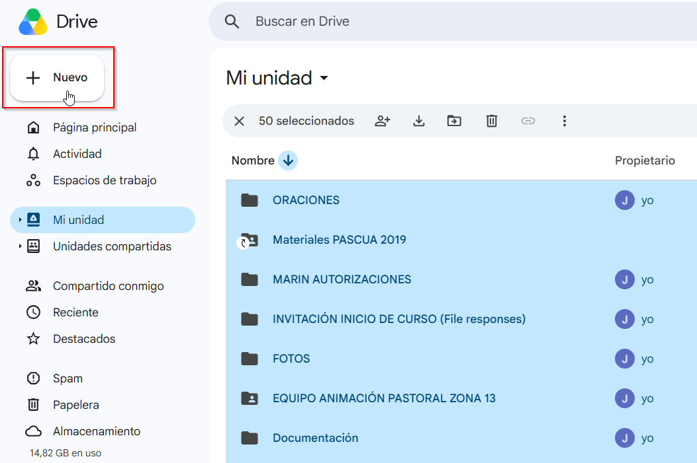
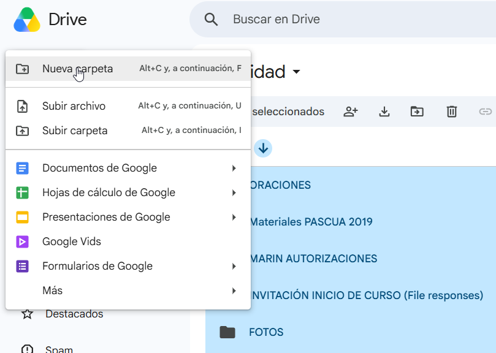
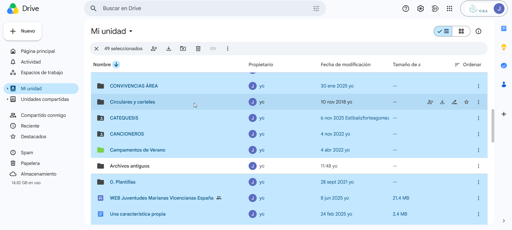
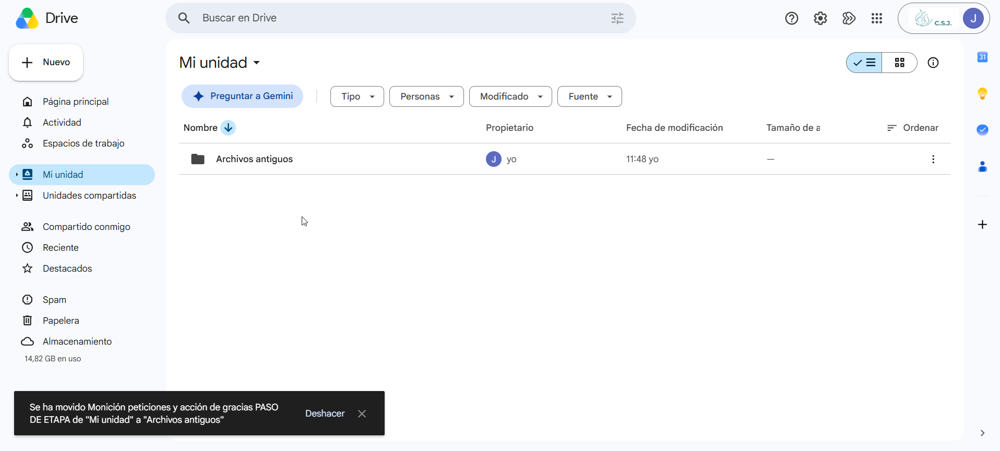

# Migra tu antigua nube sin descargar nada

Esta guía se apoya en cómo funcionan las **unidades
compartidas**: lo que hay dentro de ellas no pertenece a ninguna persona, sino a
la organización. Así que basta con **mover** tu carpeta antigua dentro de la
unidad compartida de tu centro: en cuanto entra, la propiedad pasa a JMV España
automáticamente.

De esta forma, no hace falta descargar nada, no se sube nada, se conserva la estructura de carpetas tal
cual está y los documentos de Google siguen siendo documentos de Google.

!!! info "Antes de empezar"

    - Hazlo desde un **ordenador**, no desde el móvil.
    - Vas a ir saltando entre las dos cuentas. Es mucho más cómodo tener la
      antigua abierta en una ventana normal y la nueva `@jmvesp.org` en una
      **ventana de incógnito**, en vez de estar cerrando sesión todo el rato.
    - Ten a mano la dirección exacta de tu correo de centro
      (`MICENTRO@jmvesp.org`).

## 1. Ordena tu Drive antiguo en una sola carpeta

En tu **cuenta antigua**:

1. Crea una carpeta en "Mi unidad" llamada **Archivos antiguos**.

 

 

2. Selecciona todos los ficheros de "Mi unidad" con **Ctrl + A** y arrástralos
   dentro de "Archivos antiguos". Si mantienes pulsado **Ctrl** y haces clic
   sobre "Archivos antiguos", la deseleccionas para no meter la carpeta dentro
   de sí misma.

3. Repite hasta que en "Mi unidad" solo quede la carpeta **Archivos antiguos**.

!!! success "Aprovecha para hacer limpieza"

    Este es el mejor momento para no migrar lo que ya no sirve. Todo lo que
    dejes fuera es trabajo que te ahorras ahora y desorden que te ahorras
    después.

!!! warning "Lo que hay en “Compartido conmigo” no es tuyo"

    Si arrastras a "Archivos antiguos" documentos que te compartió otra persona,
    no se moverán: siguen perteneciendo a quien los creó y Drive no puede
    cambiarles el propietario. No pasa nada por intentarlo —Drive te dará
    después la lista de los que se han quedado fuera— pero si ya sabes cuáles
    son, déjalos aparte y te ahorras el repaso del paso 4.

## 2. Da acceso de Administrador a tu cuenta antigua

Ahora, desde tu **cuenta corporativa `@jmvesp.org`**:

1. Abre Drive y entra en **Unidades compartidas** → la unidad compartida de tu
   centro.
2. Pulsa sobre el nombre de la unidad arriba del todo y elige **Gestionar
   miembros**.
3. Escribe la dirección de tu **cuenta antigua de Gmail**.
4. En el desplegable de la derecha, elige **Administrador**.
5. Pulsa **Enviar**.

> 📸 **Falta captura:** el cuadro de "Gestionar miembros" con el correo antiguo
> escrito y el desplegable abierto mostrando **Administrador**.
> Guardar como `docs/assets/img/migrar-nube-sin-descargas/01.png`.
>
> Al hacer estas capturas sobre un Drive real, **tapa antes de subirlas**
> nombres de socios, correos personales y nombres de archivo con datos
> identificables: esta web es pública. Lo tienes explicado en
> [Subir imágenes](../Editar esta web/subir-imagenes.md).

!!! danger "Esto es un permiso temporal, y hay que retirarlo"

    Mientras dure la migración, esa cuenta personal puede ver, mover y borrar
    **todo** lo que haya en la unidad compartida del centro, incluidos los datos
    de socios y de menores. Por eso el paso 6 de esta guía es quitárselo, y no
    es opcional.

## 3. Mueve la carpeta entera

Vuelve a tu **cuenta antigua**. Ahora verás en su Drive, en el menú de la
izquierda, la sección **Unidades compartidas** con la unidad de tu centro.

1. Haz clic con el botón derecho sobre la carpeta **Archivos antiguos** y elige
   **Organizar** → **Mover**.
2. Elige la unidad compartida de tu centro como destino y confirma con
   **Mover**.
3. Drive te avisará de que **el propietario de los archivos va a cambiar** y de
   que la acción no se puede deshacer. Es exactamente lo que buscamos: acepta.

> 📸 **Falta captura:** el selector de destino con la unidad compartida del
> centro elegida.
> Guardar como `docs/assets/img/migrar-nube-sin-descargas/02.png`.

> 📸 **Falta captura:** el aviso de Drive que advierte del cambio de propietario
> antes de confirmar el movimiento.
> Guardar como `docs/assets/img/migrar-nube-sin-descargas/03.png`.

!!! info "Con muchos archivos tarda un rato"

    Puedes cerrar la pestaña: el movimiento sigue en los servidores de Google
    aunque apagues el ordenador.

    Drive no mueve más de 100.000 elementos de una vez. Si tu Drive es más
    grande que eso, no muevas "Archivos antiguos" entera: entra dentro y ve
    moviendo sus subcarpetas una a una.

## 4. Revisa la lista de lo que no se ha podido mover

Cuando termina, Drive te dice si algo se ha quedado fuera y te ofrece
**descargar la lista** en un archivo `.csv`. 

Ahí están los archivos que Drive no ha
movido, que casi siempre son de un solo tipo: **documentos que pertenecen a otra
persona** y que solo estaban compartidos contigo. En su sitio, Drive deja un
acceso directo, que es solo un atajo al archivo original, no una copia.

> 📸 **Falta captura:** el aviso final de Drive con el enlace para descargar la
> lista de archivos no movidos.
> Guardar como `docs/assets/img/migrar-nube-sin-descargas/04.png`.

Qué hacer con ellos, en
[Archivos que no se pudieron mover](migrar-nube.md). 

!!! warning "Si una carpeta entera se ha negado a moverse"

    Cuando dentro de una carpeta hay demasiados archivos de otras personas
    —25 o más, o más de uno de cada diez—, Drive no mueve **la
    carpeta entera**, no solo esos archivos.

    La solución: crea en tu Mi unidad una carpeta aparte, llamada por ejemplo
    "De otras personas", mueve ahí los archivos que aparecen en la lista, y
    repite el paso 3 con la carpeta que se había quedado atrás.

## 5. Ordena el contenido en su sitio

Ya está todo dentro de la unidad compartida y es propiedad de JMV España. Ahora,
desde la cuenta corporativa, colócalo donde toca: Secretaría, Tesorería y
Actividades tienen cada una su carpeta, y hay documentos que no deben convivir
con los datos de socios.

Lo tienes explicado en
[Unidades compartidas: qué y para qué](../Corporativo/Políticas/unidades-compartidas.md)
y en
[Protección de datos en Google Drive](../Corporativo/Políticas/proteccion-datos.md).

!!! info "Revisa lo que estuviera compartido por enlace"

    Las unidades compartidas no permiten enlaces públicos como los de "Mi
    unidad". Si alguno de esos documentos estaba compartido por enlace con
    familias o con otros centros, ese enlace dejará de funcionar sin más aviso.

    Los documentos realmente públicos —una circular, un cartel— es mejor
    dejarlos en la "Mi unidad" de la cuenta corporativa. Puedes sacarlos de la
    unidad compartida moviéndolos, ahora que ya son vuestros.

## 6. Retira el acceso de Administrador a la cuenta antigua

Este paso cierra la migración. **No lo dejes para otro día.**

Antes de darlo, comprueba dos cosas:

- Que en la unidad compartida está todo lo que esperabas encontrar.
- Que ya has resuelto los archivos de la lista del paso 4 (o que sabes que no
  te importan).

Después, desde la **cuenta corporativa**:

1. Unidades compartidas → la unidad de tu centro → **Gestionar miembros**.
2. Busca la dirección de la cuenta antigua.
3. En su desplegable, elige **Quitar acceso**.

> 📸 **Falta captura:** el desplegable de un miembro con la opción **Quitar
> acceso** señalada.
> Guardar como `docs/assets/img/migrar-nube-sin-descargas/05.png`.

Los archivos se quedan donde están: ya no son suyos. Lo único que desaparece es
el acceso de una cuenta personal a la unidad de trabajo del centro, que es como
debe estar.
