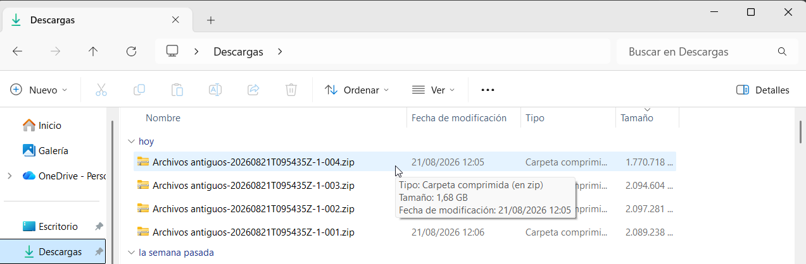
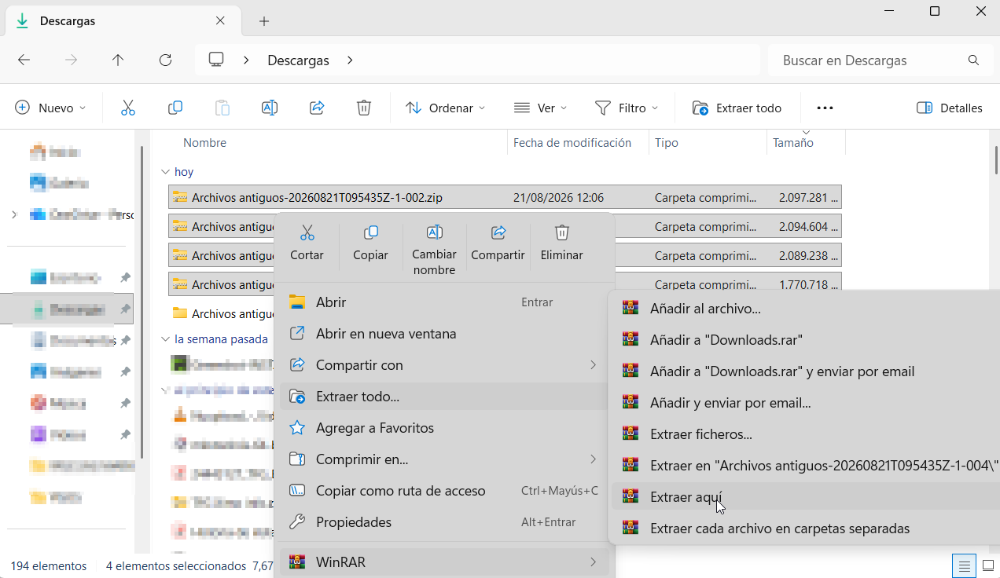
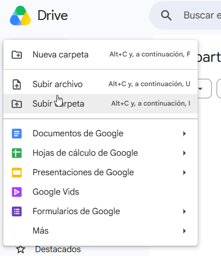
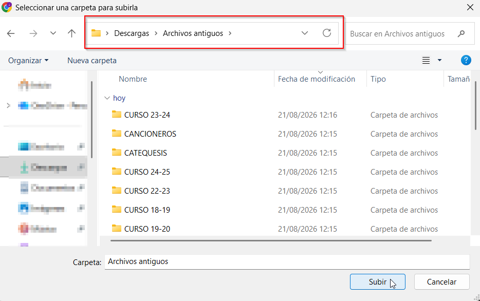

# Archivos que no se pudieron mover

!!! info "Esta guía es el remate de otra"
    Si has llegado aquí directamente, empieza por
    [Migra tu antigua nube sin descargar nada](migrar-nube-sin-descargas.md):
    con ella se mueve de una vez todo tu Drive antiguo a la unidad compartida
    del centro, sin descargar nada.

    Esta página es solo para el resto: los pocos archivos que Drive no ha
    podido mover y que te ha listado en un `.csv` al terminar.

Drive no puede cambiar el propietario de un archivo que pertenece a otra
persona, aunque lo tengas en tu Drive desde hace años. Por eso esos archivos se
quedan atrás, y por eso hay que traerlos de otra manera.

Abre la lista `.csv` con Hojas de cálculo de Google y mira cuántos son. Lo
normal es que sean unos pocos, y que ni siquiera te interesen todos: cosas que
alguien te compartió en su día y que no forman parte de la documentación del
centro. Migra solo lo que de verdad necesita el centro.

## Opción A: pedírselo a su dueño

Es la más limpia, y la única que conserva el archivo tal cual, con sus
comentarios y su historial.

Escribe a la persona propietaria y pídele que suba ella misma el documento a la
unidad compartida de vuestro centro, o que te lo comparta como **Editor** para
que puedas copiarlo. Si es alguien del centro que ya tiene cuenta
`@jmvesp.org`, mejor todavía: que lo mueva directamente a la unidad compartida.

## Opción B: copiarlo desde la cuenta corporativa

Sirve cuando el documento es un Documento, una Hoja o una Presentación de
Google, y tienes acceso a él.

1. Inicia sesión con tu **cuenta corporativa `@jmvesp.org`**.
2. Abre el archivo (el enlace está en la lista `.csv`).
3. Menú **Archivo** → **Hacer una copia**, y guárdala dentro de la unidad
   compartida de tu centro.

La copia es tuya desde el primer momento y sigue siendo un documento de Google.
Lo que se pierde son los comentarios y el historial de versiones; el contenido,
no. Si el propietario ha desactivado la opción de copiar, pasa a la opción C.

## Opción C: descargar y volver a subir

El último recurso, y el único que obliga a pasar los archivos por tu ordenador.
Va bien para PDF, fotos o documentos de Word y Excel.

1. Desde tu **cuenta antigua**, selecciona esos archivos y descárgalos. Si son
   varios, Drive te los dará en uno o varios `.zip`.

2. Si se han descargado como `.zip`, descomprímelos: botón derecho sobre el
   archivo → **Extraer aquí** (en Windows con WinRAR o con el propio
   explorador; en Mac basta con hacer doble clic).

3. Inicia sesión con tu **cuenta corporativa**, entra en la unidad compartida de
   tu centro y arrastra ahí los archivos.

 

!!! warning "Ojo con los documentos de Google"
    Al descargarlos, los Documentos, Hojas y Presentaciones de Google dejan de
    ser documentos de Google: se convierten en `.docx` y `.xlsx`, y por el
    camino se pierden los comentarios y el historial de versiones.

    Para esos, usa la opción A o la B. Deja la descarga para los archivos que ya
    eran archivos: PDF, fotos, vídeos, Word, Excel.

!!! warning "Consulta la política sobre “Mi Unidad” y las Unidades Compartidas"

    Toda la info aquí:
    [Unidades compartidas: qué y para qué](../Corporativo/Políticas/unidades-compartidas.md)

 
