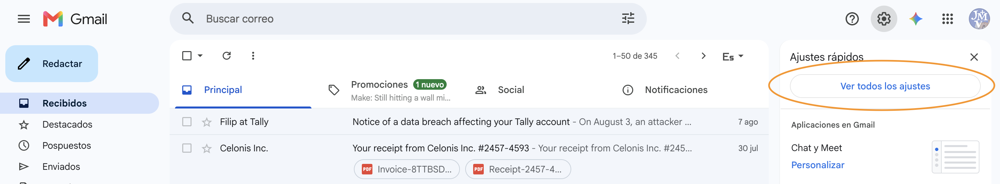
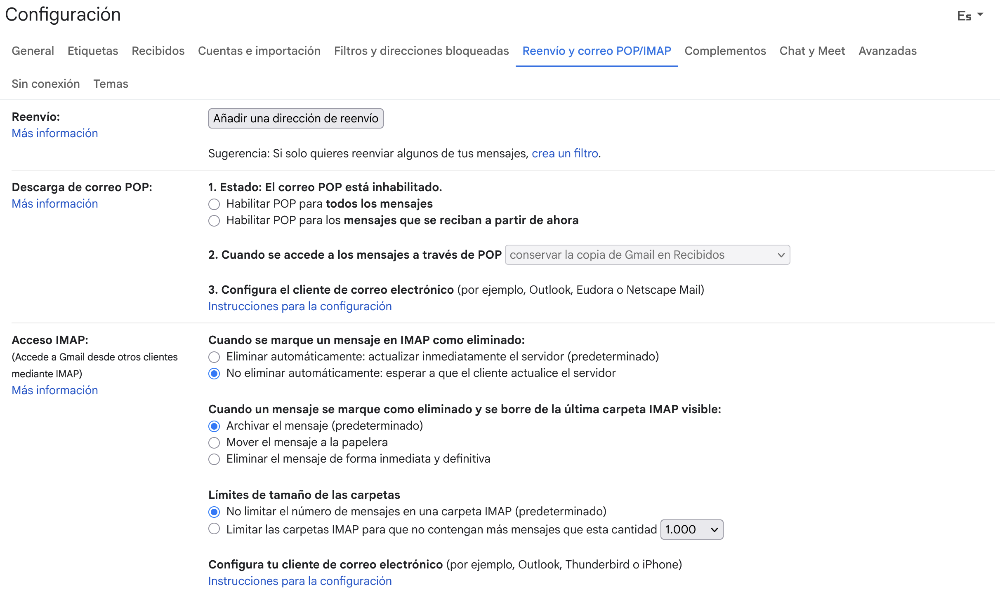
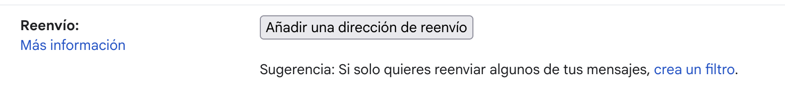
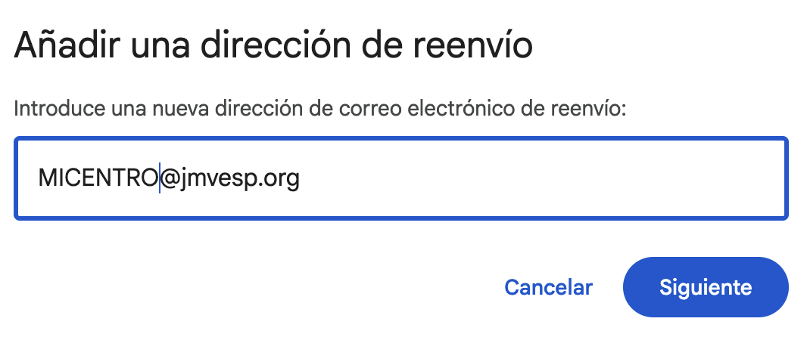
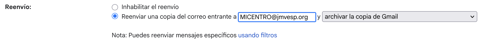
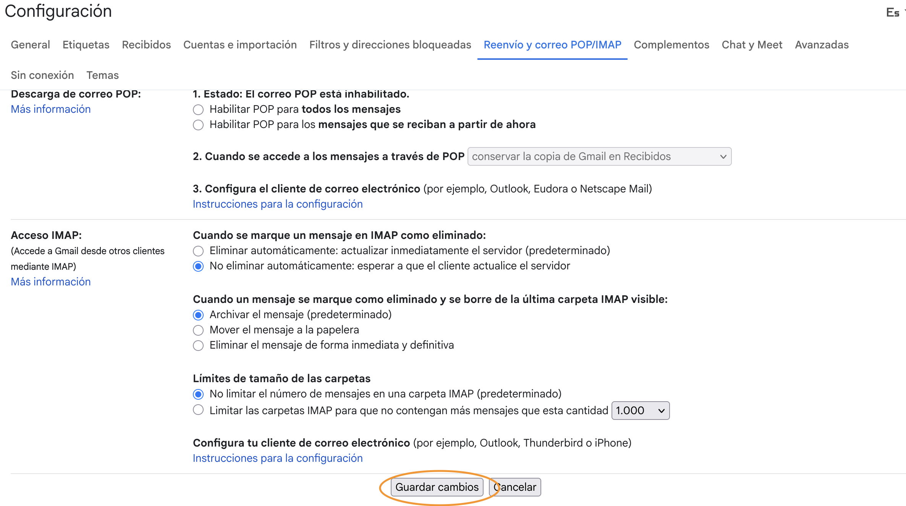

# Redirige tu antiguo email de centro
!!! danger "Importante"
    Es mucho más efectivo importar la cuenta de Gmail completa, con todo el historial, contactos y nuevos correos. Sigue las instrucciones para hacerlo aquí: [Importar la cuenta de Gmail antigua](importar-gmail.md)

    Utiliza esta guía solamente si no has podido hacer la importación o quieres seguir recibiendo emails de tu antigua cuenta pasados 30 días desde la importación.

Muchas familias, empresas con las que contratamos servicios, antiguos socios... tienen nuestros emails de centro.

Para que no tengan ningún problema al contactarnos, debemos redirigir esos emails a nuestro nuevo correo de centro jmvesp.org.

Aquí tienes los pasos para hacerlo desde una cuenta de Gmail personal (no institucional).

1. Abre tu antigua cuenta de **Gmail de centro** en un ordenador.
2. Haz clic en el icono de **Configuración** (la rueda dentada) en la esquina superior derecha y selecciona **Ver todos los ajustes**.

    

3. Entra en la pestaña **Reenvío y correo POP/IMAP**.

    

4. En la sección "Reenvío", haz clic en el botón **Agregar una dirección de reenvío**.

    

5. Escribe tu **dirección de correo corporativo (la que termina en jmvesp.org)** y haz clic en *Siguiente*, luego en *Continuar* y en *Aceptar*. Gmail te pedirá verificar tu identidad mediante contraseña, 2FA o passkey según tengas configurado.

    

6. Ve a la bandeja de entrada de tu **correo corporativo** y busca el mensaje de confirmación de Google. Haz clic en el **vínculo de verificación** que contiene ese correo.
7. Regresa a la pestaña de configuración en tu **Gmail de centro**, actualiza el navegador y selecciona la opción **Reenviar una copia del correo entrante a...**.

    

8. Elige qué quieres hacer con el correo original. Te recomendamos "archivar la copia de Gmail".
9. Haz clic en **Guardar los cambios** al final de la página (tendrás que hacer scroll hacia abajo)

    

!!! info "Información"
    Te recomendamos que también migres tu bandeja de entrada. Para ello, mira la guía [Importar la cuenta de Gmail antigua](importar-gmail.md)

 
